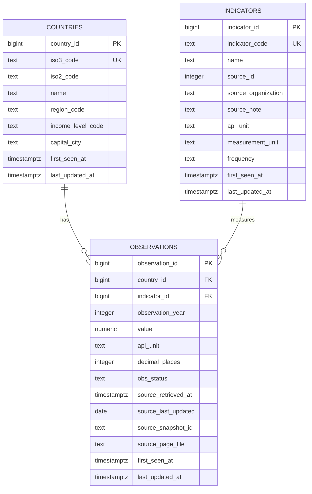

# Milestone 2 database design

This document describes `../db/schema.sql`, which has been applied and verified
in Supabase. The saved snapshot was successfully loaded: 20 countries, three
indicators, and 960 observations (950 numeric values and ten NULL values).
All five analytical queries executed successfully; results are documented in
`query_findings.md`. These statements report prior verification, not a new run.

## Relationships and row meanings

Observations additionally have a composite UNIQUE constraint on
`(country_id, indicator_id, observation_year)`. Neither foreign key is unique
individually.

| Table | Meaning of one row | Example |
|---|---|---|
| `countries` | Current downloaded descriptive metadata for one selected country. | United States, source code `USA`. |
| `indicators` | One annual indicator definition with source and unit context. | `FP.CPI.TOTL.ZG`, annual consumer-price inflation. |
| `observations` | Latest accepted returned record for one country, indicator, and measurement year, including a genuinely missing value. | USA / inflation / 2020. |

Each observation references exactly one country and one indicator. Each parent
may have zero or many observations. `ON DELETE RESTRICT` prevents deleting a
parent while observations still reference it.

## Keys, types, and constraints

All primary keys are `bigint GENERATED ALWAYS AS IDENTITY`. Source identifiers
remain required and unique as `iso3_code` and `indicator_code`. The loader
must resolve source `countryiso3code` (`USA`) to country metadata, rather than
joining the nested observation `country.id` (`US`) to the ISO3 key.

Country ISO3 codes must be three uppercase letters. Optional ISO2 codes may be
NULL, blank, or two uppercase letters. Descriptive metadata are nullable so
incomplete labels do not discard usable measurements. Preserve blank API
metadata strings; they do not imply zero or a missing observation.

Indicator `source_id` is an **integer NOT NULL without a fixed-source CHECK**.
The selected snapshot uses source 2, but the schema does not require that value.
Indicator codes and interpreted measurement units must be nonblank. Frequency
is constrained to `annual`, matching this project's observation grain.

Observation country, indicator, year, retrieval timestamp, snapshot ID, and page
filename are required. Snapshot IDs and page filenames must be nonblank.
Years are integers constrained to 1900–2100; the loader must separately
validate each run's requested window. This keeps the schema usable after 2026.
Optional display precision must be nonnegative.

`value` is nullable, unconstrained-precision `numeric`. NaN and positive/negative
infinity are rejected. Zero and negative values remain valid. No universal
0–100 bound is appropriate for inflation and GDP growth. The loader
should parse raw JSON numbers as decimals and avoid rounding to the API's
`decimal` display precision.

The composite observation key rejects duplicate inflation records for one
country and year while allowing unemployment and GDP growth for that same
country and year. It is the loader's insert conflict target.

## Missing data and interpretation

A returned JSON null becomes SQL NULL in an existing observation row. An omitted
country/indicator/year combination creates no row. Neither condition means
zero. The loader must not manufacture rows or fill values. `COUNT(value)`
counts numeric measurements; `COUNT(*)` counts returned records. Expected-grid
queries can identify absent combinations.

`api_unit` preserves provider metadata, including blanks. `measurement_unit`
records the documented interpretation: annual percent for inflation and GDP
growth, and percent of the total labor force for modeled unemployment. Blank
raw units do not mean unitless values. Definitions, providers, and licensing
context are documented in `data_dictionary.md`.

Country region and income metadata are current classifications, not historical
attributes for each measurement year. Cross-country comparisons must use shared
numeric years and disclose exclusions, following `data_quality.md`. Annual
national indicators provide budget-review context, not a business's actual
expenses. These rules require appropriate queries and assistant behavior.

## Audit timestamps and provenance

Every table has required `first_seen_at` and `last_updated_at` columns of type
`timestamptz`, defaulting to `now()`. A CHECK requires `last_updated_at` to be at
least `first_seen_at`. These are database event times, not measurement years or
provider publication dates.

There is no automatic update trigger. The loader must preserve
`first_seen_at`, advance `last_updated_at` when stored source content changes,
and leave both unchanged on an identical repeat load.

For observations, `source_retrieved_at` identifies the accepted snapshot's
retrieval time. Nullable `source_last_updated` stores the provider's page-level
update date. `source_snapshot_id` and `source_page_file` locate the raw evidence.
For unchanged records, retain their accepted provenance; later sync logs can
record repeated checks without implying a content revision.

This model stores latest accepted values, not a full revision archive. Local raw
snapshots retain retrieval evidence. Reconstructing multiple vintages through
SQL would require a future history table. Country and indicator metadata
provenance remains in raw snapshots rather than separate per-row database fields.

## Loaded snapshot

The successful load used
`data/raw/world_bank/20261102T041022160331Z/manifest.json`, the latest complete
local run identified during inspection. Read-only database checks confirmed
the counts below after loading.

| Property | Selected snapshot |
|---|---|
| Status | `complete` |
| Retrieval started | `2026-11-02T04:10:22.160331+00:00` |
| Countries / indicators | 20 / 3 |
| Observation rows | 960 |
| Numeric / null values | 950 / 10 |
| Returned years | 2010–2025 |
| Requested years | 2010–2026 |
| Absent 2026 combinations | 60 |
| Saved API pages | 16 |

The older verification and quality reports cite the November 1 snapshot. The
selected newer run has the same reported counts; equal counts alone do not
establish that every value is identical. Those reports are unchanged here.
The ten-row portable sample is not the full load input.

## Scope and future access roles

Removing the source CHECK does not provide full multi-source support. Indicator
codes remain globally unique. Multiple datasets with overlapping codes or
competing measurements may require a sources table, source-scoped indicator
uniqueness, revised observation keys, and frequency or geography changes.

The proposed `app_reader` role receives schema usage and SELECT on the three
data tables in `db/roles.sql`. Application and chatbot connections should use
that limited role; provisioning and authorized loading remain separate.
The role SQL is prepared but has not been applied or permission-tested.
See `access_roles.md` for prerequisites and the verification plan. No roles,
grants, passwords, or connection configuration were changed during preparation.

The SQL wraps all three table definitions in one transaction. It deliberately
omits `IF NOT EXISTS` so an incompatible existing table cannot be silently
accepted. Reapplying it is not a migration strategy. Loader idempotency was
verified separately: a repeat load inserted zero new rows and preserved existing
records and audit timestamps. Sync logging, evaluation, and agent tables are
later work.
